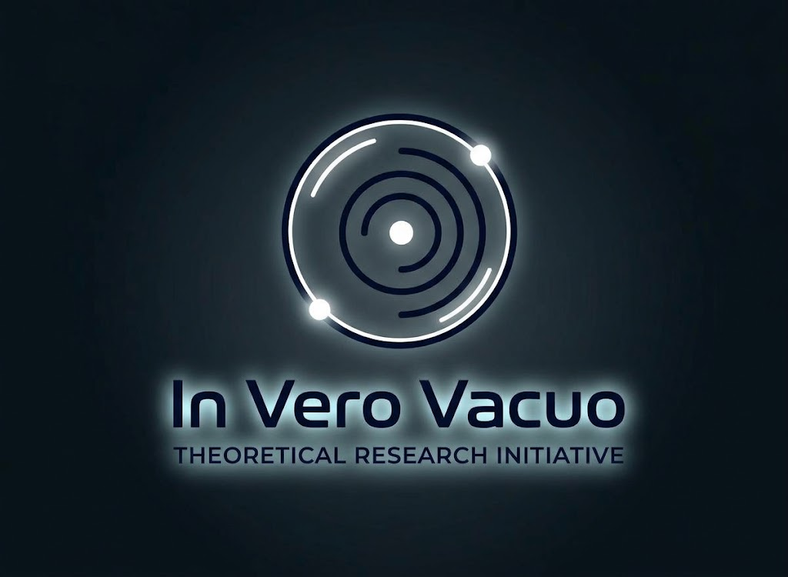

<h1>Modern Lattice Methods for Quantum Field Theory</h1>

I develop numerical techniques for computing fluctuation determinants in scalar and gauge theories — enabling decay‑rate prefactors to be calculated in regimes where traditional analytic methods fail. My work focuses on validated SU(2) lattice machinery, nonlinear vertices, and stochastic‑Lanczos determinant evaluation.

Traditional O(4) methods break down in many physically relevant scenarios. This project builds tools for metastability studies in multi‑field potentials, finite‑temperature backgrounds, curved spacetimes, and gauge theories with nontrivial structure.

<h2>Quick Links</h2>
<ul>
  <li><a href="research.md">Research Overview</a></li>
  <li><a href="methods.md">Methods & Tools</a></li>
  <li><a href="results.md">Results</a></li>
  <li><a href="reports.md">Reports</a></li>
  <li><a href="about.md">About</a></li>
  <li><a href="collaborators.md">Collaborators</a></li>
  <li><a href="news.md">News & Updates</a></li>
</ul>
